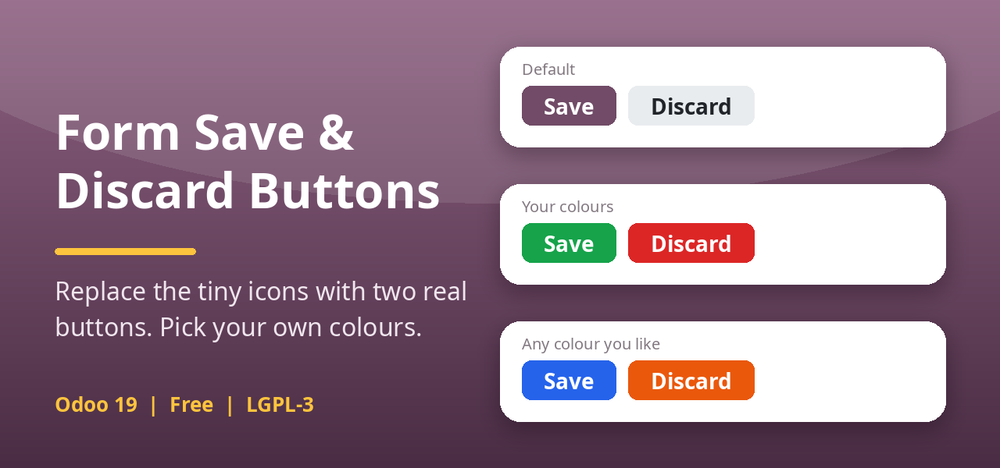

# form_action_buttons

Odoo 19 module **Form Save & Discard Buttons**: replaces the tiny cloud and cross icons in the
top-left corner of every form with two real **Save** and **Discard** buttons whose background and
text colours are configurable (Settings > Form Buttons).

* Odoo 19.0, free, LGPL-3
* Module folder: [`form_action_buttons/`](form_action_buttons) (see its README for details)

## Install

Copy the `form_action_buttons` folder into your addons path, update the apps list and install
"Form Save & Discard Buttons".

Author: H.M.Nizum
